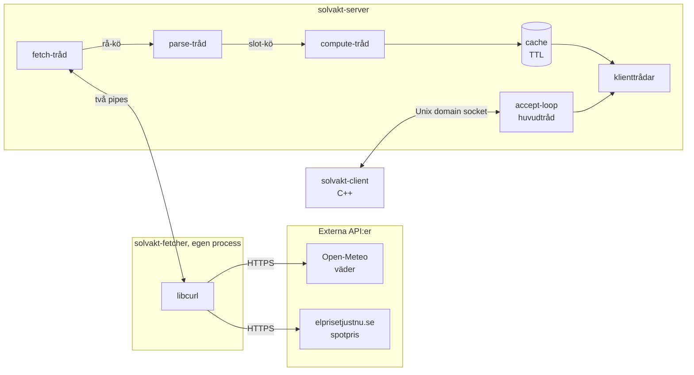
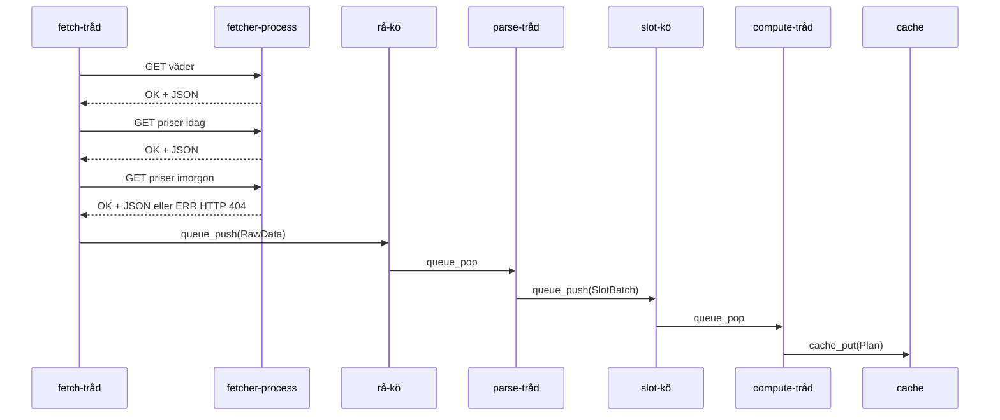
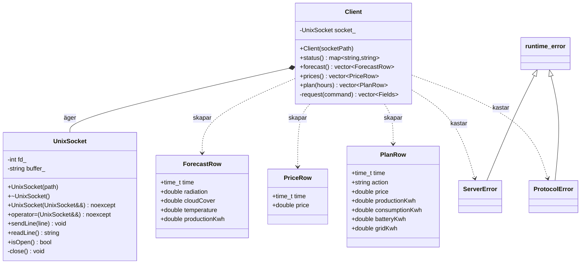

# Solvakt – arkitektur

Dokumentet beskriver hur systemet är uppbyggt, hur processer och trådar samarbetar, hur minnet hanteras och vilka designval som gjorts.

## 1. Översikt

Systemet består av två processer som alltid kör tillsammans, och en klient som startas vid behov.



| Krav i uppgiften | Var det uppfylls |
|---|---|
| Server i C | `src/server/`, `src/common/` |
| Pipeline fetch → parse → compute → cache | Tre trådar och två köer i `server.c` |
| Minst en del i separat process | `solvakt-fetcher`, startad med `fork()` + `execl()` |
| IPC via sockets, pipes eller delat minne | Pipes mot fetchern, Unix domain socket mot klienten |
| C++-klient med RAII och STL | `src/client/` |

## 2. Moduler

| Modul | Filer | Ansvar |
|---|---|---|
| Loggning | `common/log.{c,h}` | Trådsäker loggning med nivå och tidsstämpel |
| Konfiguration | `common/config.{c,h}` | Läser och validerar `solvakt.conf` |
| Kö | `common/queue.{c,h}` | Begränsad producent-konsument-kö |
| Typer | `common/types.h` | `Slot`, `PlanSlot`, `Plan`, `Action` |
| Fetcher-hantering | `server/fetcher_proc.{c,h}` | Startar, pratar med, övervakar och stoppar barnprocessen |
| Parse | `server/parse.{c,h}` | JSON → kvartsintervall, validering, matchning väder/pris |
| Compute | `server/compute.{c,h}` | Solproduktion och energiplan |
| Cache | `server/cache.{c,h}` | Senaste plan med TTL |
| Server | `server/server.{c,h}`, `server/main.c` | Trådar, socket, klientprotokoll, livscykel |
| Fetcher | `fetcher/main.c` | HTTP-hämtning med libcurl |
| Klient | `client/*.{hpp,cpp}` | `UnixSocket`, `Client`, kommandorad |

Varje C-modul har en header som är dess gränssnitt och en `.c`-fil med implementationen; hjälpfunktioner är `static`. `Server` är en ogenomskinlig typ (`typedef struct Server Server;`), så `main.c` kommer bara åt den genom `server_create`, `server_run` och `server_destroy`.

Parse, compute, cache och kö känner inte till trådar eller sockets utanför sig själva och kan därför testas var för sig (se `tests/`).

## 3. Processer

```
solvakt-server (PID n)
└── solvakt-fetcher (barnprocess)
```

### Varför fetchern är en egen process

Nätverksanrop är den del som oftast går fel: DNS, TLS, timeouts och trasiga svar. Med hämtningen i en egen process kan ett fel i libcurl eller ett hängt anrop inte ta ned servern, och servern kan fortsätta svara klienter ur cachen medan fetchern startas om.

### Start

`fetcher_start()` i `fetcher_proc.c`:

1. Skapar två pipes med `pipe()`: en för förfrågningar, en för svar.
2. `fork()`.
3. I barnet: `dup2()` kopplar pipe-ändarna till stdin och stdout, alla fyra ursprungliga fildeskriptorer stängs, sedan `execl()`. Misslyckas `execl` avslutas barnet med `_exit(127)`.
4. I föräldern: de två ändar som bara barnet använder stängs. Annars skulle servern aldrig få EOF när fetchern dör, eftersom en skrivände fortfarande vore öppen.

Serverns egna ändar får `FD_CLOEXEC`, och den lyssnande socketen och loggfilen öppnas med `SOCK_CLOEXEC` respektive `"e"`, så att en fetcher aldrig ärver fildeskriptorer den inte ska ha.

### Övervakning och stopp

- Fetch-tråden anropar `fetcher_reap_if_dead()` var 200:e millisekund medan den väntar på nästa hämtning. Funktionen använder `waitpid(pid, &status, WNOHANG)`; har barnet avslutats städas det upp direkt och en ny fetcher startas. Det blir alltså ingen zombieprocess liggande.
- Vid stopp stänger `fetcher_stop()` pipes. Fetchern får EOF på stdin och avslutar sig själv. Servern väntar upp till en sekund med `waitpid` och skickar annars `SIGKILL` och väntar in den.
- Fetchern ignorerar `SIGINT`, så Ctrl-C i terminalen (som går till hela processgruppen) dödar den inte innan servern hunnit stänga ned i ordning.

## 4. Trådar och synkronisering

| Tråd | Antal | Gör |
|---|---|---|
| Huvudtråd | 1 | `accept`-loop, startar och stoppar allt |
| Fetch | 1 | Hämtar väder och priser via fetchern var 15:e minut |
| Parse | 1 | Tolkar och validerar JSON, matchar väder mot pris |
| Compute | 1 | Beräknar planen och lägger den i cachen |
| Klient | 1 per anslutning | Läser kommandon och skickar svar |

### Pipeline



### Kön

`Queue` är en ringbuffert av pekare med fast kapacitet, skyddad av en mutex och två villkorsvariabler:

- `not_empty` – konsumenten väntar här när kön är tom.
- `not_full` – producenten väntar här när kön är full.

Väntan sker alltid i en `while`-loop runt `pthread_cond_wait`, eftersom en tråd kan väckas utan att villkoret gäller. `queue_close()` sätter en flagga och väcker alla väntande med `pthread_cond_broadcast`; därefter misslyckas `queue_push`, medan `queue_pop` lämnar ut det som redan ligger i kön och sedan returnerar -1. Det är så parse- och compute-trådarna får veta att de ska avsluta.

### Delade resurser

| Resurs | Delas av | Skydd |
|---|---|---|
| `raw_queue`, `slot_queue` | fetch/parse, parse/compute | Köns mutex |
| `Cache` | compute-tråden (skriver), klienttrådar (läser) | `cache.mutex` |
| `running` | alla trådar | `atomic_bool` |
| `clients` (antal klienttrådar) | huvudtråd, klienttrådar | `clients_mutex` + villkorsvariabel |
| Loggfilen | alla trådar | Mutex i `log.c` |
| `Fetcher` | bara fetch-tråden medan systemet kör | Inget lås behövs |
| `g_stop` | signalhanterare, huvudtråd | `volatile sig_atomic_t` |

`cache_get()` kopierar hela planen till anroparens buffert medan låset hålls. Läsaren arbetar sedan på sin kopia, så låset hålls bara under en `memcpy` på 23 kB och en långsam klient kan inte blockera compute-tråden.

Ingen tråd håller mer än ett lås åt gången, så låsordningen kan inte ge deadlock.

### Verifiering

- `tests/test_queue.c` kör fyra producenter och tre konsumenter mot en kö med åtta platser och kontrollerar att inget element tappas eller dupliceras.
- `tests/test_cache.c` låter fyra läsare och en skrivare arbeta samtidigt och kontrollerar att ingen läsare ser en halvskriven plan.
- Båda testerna har körts under ThreadSanitizer (`-fsanitize=thread`) utan rapporterade datakapplöpningar. Helgrind ger på den här plattformen (glibc 2.39, Valgrind 3.22) en varning inifrån `pthread_cond_wait` även för korrekt kod, så ThreadSanitizer användes i stället.

## 5. Start och stopp

### Start (`main.c`)

1. Läs och validera konfigurationen. Fel ger utskrift och returkod 1 innan något annat startas.
2. Öppna loggen och installera signalhanterare.
3. `server_create()`: skapa köer och cache, öppna den lyssnande socketen, starta fetchern.
4. `server_run()`: starta de tre pipeline-trådarna och gå in i `accept`-loopen.

Om socketfilen redan finns provar servern att ansluta till den. Svarar någon kör redan en server och den nya avslutar med fel; annars är filen kvar efter en krasch och tas bort.

### Stopp

`SIGINT` och `SIGTERM` hanteras med `sigaction`. Hanteraren gör bara en sak, sätter `g_stop`, eftersom nästan inget annat är säkert att göra i en signalhanterare. `accept`-loopen använder `poll()` med 200 ms timeout och ser flaggan vid nästa varv.

Nedstängningen sker sedan i den här ordningen:

1. `running = false` – fetch-tråden och klienttrådarna avbryter sina väntelägen.
2. Båda köerna stängs – parse- och compute-trådarna vaknar ur `queue_pop`.
3. `pthread_join` på fetch, parse och compute.
4. `fetcher_stop()` – stäng pipes, `waitpid`.
5. Vänta upp till tre sekunder på att klienttrådarna räknar ned till noll.
6. Stäng socketen, `unlink` på socketfilen, töm och frigör köerna.

`SIGPIPE` ignoreras i både server och fetcher, och servern skickar till klienter med `MSG_NOSIGNAL`. En motpart som försvinner ger då felkoden `EPIPE` i stället för att döda processen.

## 6. Dataflöde och beräkning

### Från API-svar till kvartsintervall

Open-Meteo anropas med `minutely_15`, `timeformat=unixtime` och `past_days=1&forecast_days=2`. Det ger 288 kvartar från 00:00 UTC igår. Gårdagen behövs eftersom spotpriserna gäller svenska kalenderdygn, som börjar 22:00 eller 23:00 UTC dagen innan.

elprisetjustnu.se anropas en gång per dygn (idag och imorgon). Varje prisrad har `time_start` och `time_end` i ISO 8601 med tidszonsoffset. `parse_prices()` räknar om till UTC och lägger priset på alla kvartar raden täcker, så både kvartspriser och äldre timpriser fungerar.

`parse_finalize()` behåller den första sammanhängande följden av kvartar som har både giltigt väder och pris. Resultatet börjar därför vid svensk midnatt och är 96 kvartar (24 h) eller 192 kvartar (48 h) långt.

### Validering

| Kontroll | Följd |
|---|---|
| Svaret är inte giltig JSON eller saknar förväntade fält | Hela svaret förkastas |
| Tidsserien har en lucka eller arrayerna är olika långa | Hela svaret förkastas |
| Instrålning utanför 0–1500 W/m², molnighet utanför 0–100 %, temperatur utanför ±70 °C, eller `null` | Kvarten räknas som utan väder |
| Pris som inte är ett tal eller ligger utanför -50–500 SEK/kWh, eller ogiltig tid | Prisraden hoppas över |
| Färre än fyra kvartar med både väder och pris | Ingen plan beräknas |

### Solproduktion

```
produktion [kWh] = instrålning [W/m²] × panelyta [m²] × verkningsgrad × 0,25 h / 1000
```

### Energiplan

Priserna i prognosen sorteras och två gränser tas fram: 25:e percentilen (lågt pris) och 75:e percentilen (högt pris). Batteriets laddning följs kvart för kvart.

| Läge | Villkor | Åtgärd |
|---|---|---|
| Överskott | Priset är inte högt och batteriet har plats | `CHARGE` – lagra, sälj det som inte får plats |
| Överskott | Annars | `SELL` |
| Underskott | Högt pris och laddning finns | `DISCHARGE` – resten köps |
| Underskott | Lågt pris och batteriet har plats | `CHARGE` – köp förbrukningen plus laddning |
| Underskott | Solen täcker minst halva förbrukningen | `USE_SOLAR` – resten köps |
| Underskott | Annars | `BUY` |

Batteriet laddas och laddas ur med högst `battery_max_kw` och håller sig mellan 0 och `battery_capacity_kwh`. Om alla priser är lika flyttas ingen energi via nätet. `tests/test_compute.c` kontrollerar energibalansen (produktion + nät = förbrukning + ändring i batteriet) och batterigränserna för varje kvart i en 72-timmarsprognos.

### Cache och TTL

Cachen håller senaste plan och tiden den lagrades. `cache_get()` returnerar `CACHE_EXPIRED` när planen är äldre än `cache_ttl_s`. Med standardvärdena hämtas ny data var 15:e minut och TTL är 30 minuter, så cachen går bara ut om två hämtningar i rad misslyckas. Klienten får då ett tydligt fel i stället för gammal data.

## 7. Minnesmodell

| Data | Var | Storlek | Livslängd och ägare |
|---|---|---|---|
| `Config` | I `Server` | ca 1 kB | Kopieras vid start, ändras inte sedan |
| `Server` | Heap | – | `server_create` → `server_destroy` |
| `RawData` + tre JSON-strängar | Heap | ca 7 + 14 + 14 kB | Skapas av fetch-tråden, ägs av rå-kön, frigörs av parse-tråden |
| `SlotBatch` | Heap | 13,8 kB (288 × 48 byte) | Skapas av parse-tråden, ägs av slot-kön, frigörs av compute-tråden |
| `Plan` i compute | Heap | 23 kB (288 × 80 byte) | Lokal för en beräkning, kopieras in i cachen |
| `Plan` i cachen | I `Server` | 23 kB | Skrivs över vid varje ny plan |
| `Plan` per klientkommando | Heap | 23 kB | Allokeras och frigörs inom `handle_command` |
| Svarsbuffert | Heap | växer vid behov | Allokeras och frigörs per kommando |

Principer:

- **Ägandet följer med genom kön.** Den som anropar `queue_push` släpper ägandet om anropet lyckas; den som får ett element från `queue_pop` ska frigöra det. Misslyckas `queue_push` (stängd kö) frigör avsändaren själv.
- **Fasta övre gränser.** `MAX_SLOTS` är 288 (72 timmar), fetchern tar emot högst 4 MB per svar, en kommandorad är högst 127 tecken. Inget i systemet växer obegränsat.
- **Stora strukturer ligger på heapen**, inte på trådarnas stackar.
- **Inga delade pekare till föränderlig data.** Trådarna utbyter antingen ägande (köerna) eller kopior (cachen).

Valgrind (`--leak-check=full --show-leak-kinds=all`) på en serverkörning med hämtning, sex klientanrop och stopp via `SIGTERM` rapporterar 5 497 allokeringar, lika många frigöranden och inga fel. Utdatat finns i [profiling/valgrind_server.txt](profiling/valgrind_server.txt). `make valgrind` kör dessutom alla enhetstester och benchmarken under Valgrind.

## 8. C++-klienten

Servern är skriven i C eftersom den arbetar direkt mot systemanrop och POSIX-trådar. Klienten är skriven i C++ där RAII, undantag och STL gör koden kortare och säkrare.



### RAII

`UnixSocket` äger fildeskriptorn. Konstruktorn ansluter och kastar `std::runtime_error` om det misslyckas; destruktorn stänger. Det finns därför ingen kodväg, inte heller när ett undantag kastas mitt i ett kommando, där socketen blir kvar öppen.

Klassen följer Rule of Five: kopiering är borttagen med `= delete` eftersom två objekt inte kan äga samma fildeskriptor, medan move-konstruktor och move-tilldelning flyttar över ägandet med `std::exchange` och lämnar källan med `fd_ = -1`.

`Client` har `UnixSocket` som medlem och behöver ingen egen destruktor (Rule of Zero). Koden innehåller inga `new`, `delete`, `malloc` eller `free`; allt dynamiskt minne ägs av `std::string`, `std::vector` och `std::map`.

### STL

| Komponent | Användning |
|---|---|
| `std::string` | All text, inga `char*`-buffertar utom vid systemanrop |
| `std::vector` | Svarsrader och typade rader |
| `std::map` | Statusnycklar, kommandotabell, antal kvartar per åtgärd |
| `std::function` | Kommandohanterare i kommandotabellen |
| `std::transform` | Fält → `ForecastRow`/`PriceRow`/`PlanRow` |
| `std::accumulate` | Summor av produktion och pris |
| `std::max_element` | Kvarten med högst produktion |
| `std::sort` | Priser i stigande ordning |
| Range-baserad `for` | All iteration över behållare |

### Felhantering

| Undantag | Betyder | Returkod |
|---|---|---|
| `ServerError` | Servern svarade `ERR` | 1 |
| `ProtocolError` | Svaret följde inte protokollet | 1 |
| `std::runtime_error` | Anslutning, timeout eller I/O-fel | 1 |
| `std::invalid_argument` | Felaktiga argument på kommandoraden | 2 |

Alla fångas på ett ställe i `main()` och ger en begriplig rad på stderr.

## 9. Felhantering i servern

| Fel | Hantering |
|---|---|
| Ogiltig konfiguration | Servern startar inte; raden och orsaken skrivs ut |
| HTTP-fel eller timeout | Varning i loggen, nytt försök inom 60 s, cachen gäller tills TTL går ut |
| Morgondagens priser saknas (404) | Planen byggs på innevarande dygn |
| Ogiltig JSON eller orimliga värden | Datat förkastas, föregående plan ligger kvar |
| Fetchern kraschar | Upptäcks inom 200 ms, städas upp och startas om |
| Fetchern svarar inte | Timeout, fetchern dödas och startas om |
| Klient skickar okänt eller felaktigt kommando | `ERR` med förklaring |
| Klient kopplar ned mitt i ett svar | `EPIPE`, klienttråden avslutas |
| Ingen data eller för gammal data | `ERR` med förklaring |
| En server kör redan på samma socket | Den nya avslutar med fel |

## 10. Loggning

Varje rad har tid, nivå, källfil och rad:

```
[2026-10-06 15:41:37] INFO  fetcher_proc.c:95: Fetcher: startad med PID 80952
[2026-10-06 15:41:37] INFO  server.c:156: Fetch: väder och priser hämtade
[2026-10-06 15:41:37] INFO  server.c:254: Compute: ny plan med 192 kvartar (48 timmar) lagrad i cachen
[2026-10-06 15:41:40] WARN  fetcher_proc.c:239: Fetcher: PID 80952 dog oväntat av signal 9
[2026-10-06 15:41:40] INFO  fetcher_proc.c:95: Fetcher: startad med PID 81007
```

Allt skrivs till loggfilen; varningar och fel skrivs dessutom till stderr. Nivån väljs med `log_level`.

## 11. Designval

| Val | Alternativ | Motivering |
|---|---|---|
| Fetchern som egen process | Tråd i servern | Isolerar nätverksfel; uppfyller kravet på separat process |
| Anonyma pipes till fetchern | Namngiven pipe, socket | Fetchern är alltid serverns barn, så inget namn i filsystemet behövs |
| Längdprefix i fetcherns svar | Radbrytning som avslut | JSON kan innehålla radbrytningar; längden gör läsningen entydig |
| Unix domain socket till klienten | TCP | Klienten är lokal; filrättigheter räcker som åtkomstkontroll och ingen port exponeras |
| Textprotokoll med tabbar | JSON | Enkelt att tolka i klienten utan bibliotek och att felsöka med `nc` |
| En tråd per klient | Trådpool, `poll` | Få och kortlivade klienter; enklast korrekta lösningen |
| Cachen lämnar ut kopior | Läs-skriv-lås | Planen är liten och läses sällan; kopian gör låstiden kort |
| Regelbaserad plan | Optimering över hela horisonten | Lätt att förklara och testa; räcker för kraven |
| libcurl i fetchern | Egen HTTP/TLS-kod | TLS är inte kursens fokus |
| cJSON | Egen JSON-tolk | Samma skäl; litet och välbeprövat bibliotek |
